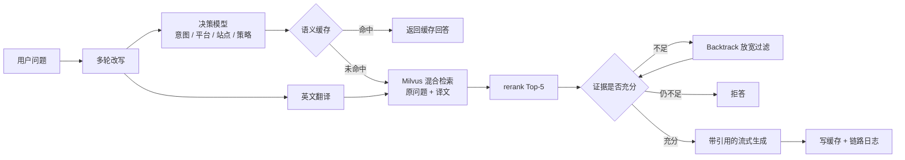

# 小贸同学

面向中小跨境卖家的规则与合规问答 SaaS。知识库收录亚马逊卖家政策，以及美国、英国、德国、欧盟的产品合规法规；回答附原文出处，检索不到可靠资料时拒答。

## 功能

- **问答**：多轮对话，SSE 流式输出，回答中的 `[n]` 对应出处列表
- **检索**：Milvus 混合检索（BGE-M3 稠密向量 + BM25），中文问题附加英文翻译召回，API rerank
- **决策层**：本地 0.8B 决策模型判断意图、平台、站点、检索策略和证据是否充分，低置信度交给大模型兜底
- **拒答**：证据不足时先放宽平台、站点过滤再检索一次（Backtrack），仍不足则拒答
- **语义缓存**：Redis 8 向量索引，相似度阈值加大模型复用判断；文档更新时按文档失效
- **SaaS**：手机号注册登录（JWT + 刷新令牌轮换）、经营画像、对话历史、每日配额与限流、点赞点踩反馈
- **前端**：React 单页应用，由 FastAPI 直接提供

## 架构



每次问答的改写结果、决策概率、缓存查找、召回片段、rerank 分数、各步耗时和 tokens 都记在 MySQL 的 `qa_trace` 表，用于排查和成本统计。

## 评估结果

评估集为 167 道问答题（138 道有答案、29 道无答案）和 326 条人工标注的意图题。

| 指标 | 结果 | 出处 |
|---|---|---|
| 检索 Hit@5 / MRR | 89.9% / 0.784 | [M4_qa.md](eval/reports/M4_qa.md) |
| 无答案题拒答率 / 有答案题误拒率 | 100% / 0% | [M4_qa.md](eval/reports/M4_qa.md) |
| 忠实度（自建评委，开思考） | 93.5% | [M4_qa.md](eval/reports/M4_qa.md) |
| RAGAS Faithfulness / Answer Relevancy / Context Precision | 0.978 / 0.819 / 0.814 | [M6_eval.md](eval/reports/M6_eval.md) |
| 意图准确率（决策模型 + 大模型兜底，阈值 0.5） | 79.8%，35% 的请求走兜底 | [M6_eval.md](eval/reports/M6_eval.md) |
| 语义缓存命中率（300 个混合请求回放） | 36.5% | [M6_eval.md](eval/reports/M6_eval.md) |
| 服务端耗时 P50：缓存命中 / 完整生成 | 1.5 秒 / 5.3 秒 | [M6_eval.md](eval/reports/M6_eval.md) |
| 每千次问答成本：有缓存 / 无缓存 | 3.8 元 / 5.5 元 | [M6_eval.md](eval/reports/M6_eval.md) |

其他报告：检索消融与 rerank 对比见 [M3_retrieval.md](eval/reports/M3_retrieval.md)，缓存阈值与服务化见 [M4b_service.md](eval/reports/M4b_service.md)，SaaS 能力见 [M5_saas.md](eval/reports/M5_saas.md)。每份报告末尾有复现命令。

同一配置重复运行，忠实度和答对率会有 4–5 个百分点的波动，小于这个幅度的差异不作结论。

## 技术栈

| 层 | 选型 |
|---|---|
| 服务 | Python 3.12、FastAPI、Uvicorn |
| 向量库 | Milvus（稠密向量 + BM25 全文检索） |
| 缓存与计数 | Redis 8（向量索引、Lua 原子配额） |
| 业务库 | MySQL 8.4 |
| 嵌入 | BGE-M3（本地） |
| 决策模型 | Jev-Style-0.8B（本地，`jev-style serve`） |
| 生成 / rerank / 评委 | 阿里云百炼：qwen3.7-flash、qwen3.7-text-rerank、qwen3.7-plus |
| 前端 | React 19、TypeScript、Vite |
| 评估 | 自建评估脚本、RAGAS 0.4 |

## 目录结构

```
├── src/xiaomao/
│   ├── ingest/        解析、切片、向量化、入库、增量更新
│   ├── retrieval/     嵌入、Milvus 检索、混合融合、rerank
│   ├── decision/      决策模型接口：jev_style、system_one、llm_json（兜底）
│   ├── router/        检索策略、翻译、证据判断、Backtrack
│   ├── generation/    生成提示词、引用解析、固定回复
│   ├── cache/         语义缓存
│   ├── user/          账号、画像、配额、限流、用量同步
│   ├── storage/       MySQL 连接池与数据访问（按 user_id 隔离）
│   ├── api/           FastAPI 接口
│   └── qa.py          问答链路
├── scripts/           抓取、数据生成与校验、入库、评估、运营脚本
├── sql/schema.sql     MySQL 建表
├── data/              数据来源清单、评估集（原始抓取和处理结果不入库）
├── eval/              探针脚本与评估报告
├── tests/             单元测试与接口测试
└── web/               前端
```

## 本地运行

### 准备

- Python 3.12 与 [uv](https://docs.astral.sh/uv/)
- Node.js 20+
- Docker（运行 Redis）
- Milvus 2.6 及以上、MySQL 8.4（自行部署）
- 阿里云百炼 API Key
- NVIDIA 显卡 6GB 及以上（运行 BGE-M3 和决策模型；rerank 默认走 API，不占显存）

### 步骤

1. 配置环境变量

   ```bash
   cp .env.example .env
   ```

   填写 `LLM_API_KEY`、`MYSQL_PASSWORD`、`REDIS_PASSWORD`、`JWT_SECRET`，以及 `EMBED_MODEL` 指向的 BGE-M3 模型目录。

2. 启动 Redis，建 MySQL 表

   ```bash
   docker compose up -d
   ```

   ```bash
   mysql -u xiaomao -p xiaomao < sql/schema.sql
   ```

3. 安装依赖并检查环境

   ```bash
   uv sync
   ```

   ```bash
   uv run python scripts/check_env.py
   ```

4. 构建知识库

   原始资料不随仓库分发。`data/sources.jsonl` 是来源清单，抓取脚本会遵守 robots.txt 并限速，需要登录或有反爬校验的页面跳过，改为手动保存后导入。

   ```bash
   uv run python scripts/crawl.py
   ```

   ```bash
   uv run python scripts/import_manual.py
   ```

   ```bash
   uv run python -m xiaomao.ingest.parse
   ```

   ```bash
   uv run python scripts/gen_faq.py --docs data/processed/documents.jsonl --out data/processed/faq_items.jsonl
   ```

   FAQ 审核通过后，再运行一次 `xiaomao.ingest.parse` 把它并入文档，然后切片、入库：

   ```bash
   uv run python -m xiaomao.ingest.chunk
   ```

   ```bash
   uv run python scripts/build_index.py
   ```

   数据格式和校验规则见 [docs/data_format.md](docs/data_format.md)。

5. 启动决策模型服务

   ```bash
   uv run jev-style serve --release 0.8b-v3 --backend torch --dtype bfloat16 --device cuda --host 127.0.0.1 --port 8765
   ```

   服务不可用时，问答链路自动改用大模型做决策。

6. 构建前端并启动服务

   ```bash
   cd web && npm ci && npm run build
   ```

   ```bash
   uv run python -m xiaomao.api
   ```

   打开 http://127.0.0.1:8000 。

### 前端开发

```bash
cd web && npm run dev
```

`npm run dev` 把 `/api` 代理到本机 8000 端口。不启动后端时可用内置的模拟接口：

```bash
cd web && npm run dev:mock
```

## 测试

```bash
uv run pytest
```

## 数据说明

知识库内容来自亚马逊卖家平台、欧盟委员会、英国政府网站、德国相关机构等公开页面，版权归原发布方所有。本仓库只包含来源清单、评估集和处理代码，不包含抓取的原文。
